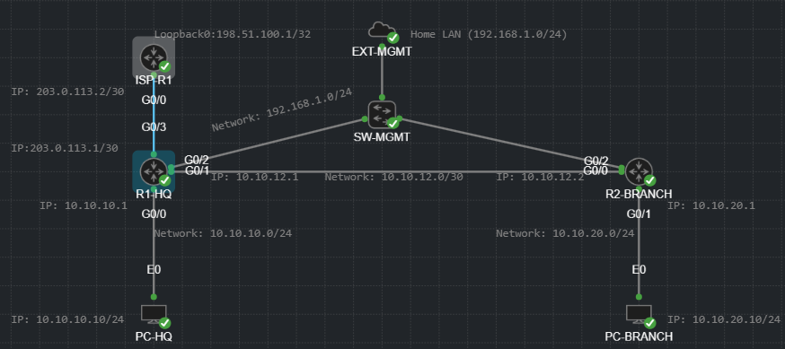

# CHG-NET-001 — Implement Default Routing to Simulated ISP

**Operation Comeback 2027 | Cisco CML | Network Administration & Engineering**

**Status:** Successfully implemented and technically validated in a simulated lab. No production network was modified.

## Overview

Extended an existing HQ-to-Branch network with a simulated ISP router. Configured static default routes from HQ and Branch toward the simulated ISP, and return routes on the ISP router, while preserving inter-site connectivity.

## Technical highlights

- **R1-HQ:** default route via `203.0.113.2` (ISP-R1)
- **R2-BRANCH:** default route via `10.10.12.1` (R1-HQ)
- **ISP-R1:** static return routes to `10.10.10.0/24` and `10.10.20.0/24`
- **External test destination:** `198.51.100.1/32` on ISP-R1 Loopback0 (documentation-only address)
- **Troubleshooting:** restored a non-running CML link and corrected missing ISP return routes

## Verification results

| Test | Result |
|---|---|
| PC-HQ → ISP loopback | PASS — 5/5, 0% loss |
| PC-BRANCH → ISP loopback | PASS — 5/5, 0% loss |
| PC-HQ → PC-BRANCH | PASS — 5/5, 0% loss |
| PC-BRANCH → PC-HQ | PASS — 5/5, 0% loss |
| Routing tables: R1-HQ, R2-BRANCH, ISP-R1 | Reviewed; screenshots available |

The documented ping tests and routing-table checks passed. Planned traceroute and persistence-after-restart tests were not evidenced or independently verified in the supplied material.

## Documentation

- [Change Management Record](docs/Change-Management-Record.md) — change scope, risks, implementation, troubleshooting, validation, rollback, closure, and evidence
- [Network Implementation & Configuration Guide](docs/Network-Implementation-Guide.md) — topology, addressing, reconstructed configuration commands, verification, and limitations

## Evidence

- [Before-change topology](evidence/CHG-NET-001-Before-Topology.png.png) and [final topology](evidence/CHG-NET-001-Final-Topology.png.png)
- Routing tables: [R1-HQ](evidence/CHG-NET-001-R1-HQ-Routing-Table.png.png), [R2-BRANCH](evidence/CHG-NET-001-R2-BRANCH-Routing-Table.png.png), [ISP-R1](evidence/CHG-NET-001-ISP-R1-Routing-Table.png.png)
- Connectivity tests: [HQ → ISP](evidence/CHG-NET-001-PC-HQ-to-ISP-Ping.png.png), [Branch → ISP](evidence/CHG-NET-001-PC-BRANCH-to-ISP-Ping.png.png), [HQ → Branch](evidence/CHG-NET-001-PC-HQ-to-BRANCH-Regression-Test.png.png), [Branch → HQ](evidence/CHG-NET-001-PC-BRANCH-to-HQ-Regression-Test.png.png)

> **Lab scope:** This project demonstrates routing in Cisco Modeling Labs. The simulated ISP is not real Internet access. Router configuration examples are reconstructed from notes and verified state rather than complete running-config exports.
