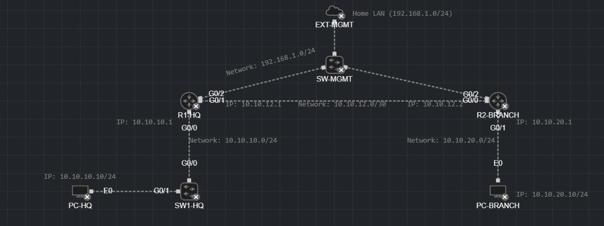
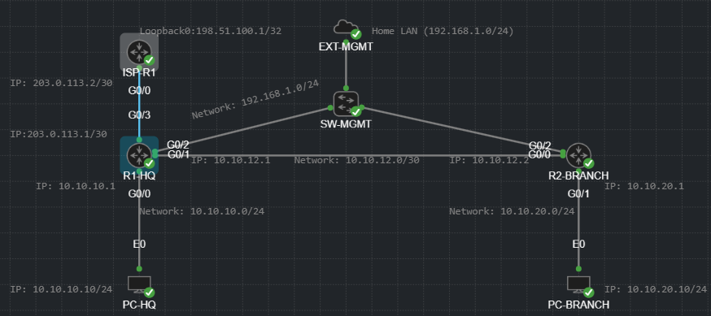
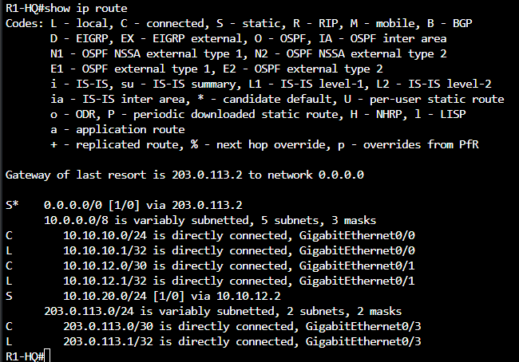
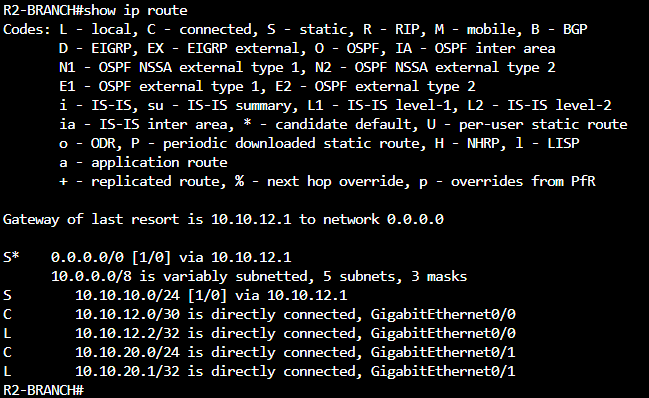
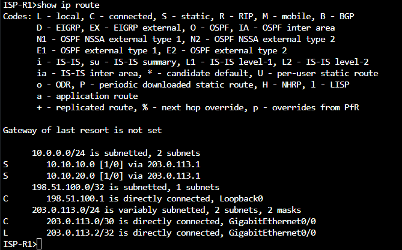
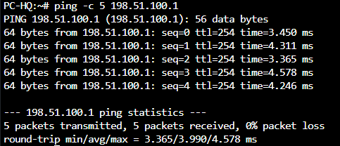
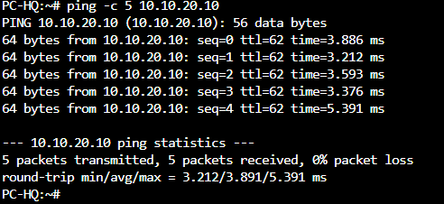
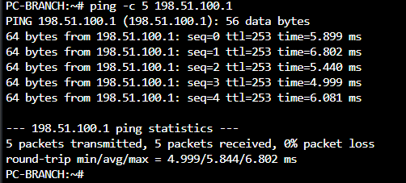
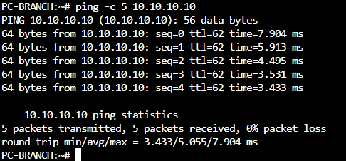

## Change Information

|Field|Value|
|---|---|
|Change ID|CHG-NET-001|
|Project|Operation Comeback 2027|
|Environment|Cisco Modeling Labs (CML-Free)|
|Related Competency|TTP 7.6 — Static & Default Routing|
|Change Type|Planned Network Change|
|Status|Successfully Implemented — Technically Validated|
|Implementation Date|Not recorded in source notes|
|Change Owner|Network Administrator (Lab Simulation)|
## 0. Executive Summary & Network Topology Overview

### 0.1 Project Overview

**Change ID:** CHG-NET-001
**Change Title:** Implement Default Routing to Simulated ISP
**Environment:** Cisco Modeling Labs (CML-Free)
**Change Status:** Successfully Implemented — Technically Validated

**Project Summary**

This change introduces a simulated Internet Service Provider (ISP) router into the existing HQ-to-Branch network.

The objective is to provide external network connectivity to both locations using default routing while preserving the existing static routing infrastructure and inter-site connectivity.

The implementation includes topology modifications, ISP-facing IPv4 addressing, static and default route configuration, connectivity validation, and rollback procedures.

### 0.2 Current Network Topology — Before Change

**Figure 1 — Original HQ-to-Branch Network Topology (Pre-Change).** Source: Cisco Modeling Labs (CML-Free).

**Current State**

- HQ and Branch communicate through an existing point-to-point WAN connection.

- Static routes provide connectivity between both LANs.

- No simulated ISP connection is configured.

- No default routes are configured on R1-HQ or R2-BRANCH.


### 0.3 Final Network Topology — After Change


**Figure 2 — Final HQ-to-Branch Network Topology with Simulated ISP.** Source: Cisco Modeling Labs (CML-Free). Final configuration validated in the lab.


**Implemented State**

- SW1-HQ is removed from the CML topology.

- PC-HQ connects directly to R1-HQ.

- ISP-R1 provides a simulated external network destination.

- R1-HQ forwards unknown destinations toward ISP-R1.

- R2-BRANCH forwards unknown destinations toward R1-HQ.

- ISP-R1 contains return routes to the HQ and Branch LANs.

- Existing HQ-to-Branch static routing is preserved.


### 0.4 Change Scope Summary

|Component|Before Change|After Change|
|---|---|---|
|HQ LAN|PC-HQ via SW1-HQ|PC-HQ directly connected to R1-HQ|
|HQ–Branch WAN|Static routing|Static routing preserved|
|ISP Router|Not present|ISP-R1 deployed|
|ISP Connection|Not configured|203.0.113.0/30|
|External Test Network|Not available|198.51.100.1/32|
|R1-HQ Default Route|Not configured|Via 203.0.113.2|
|R2-BRANCH Default Route|Not configured|Via 10.10.12.1|
|ISP Return Routing|Not applicable|Static routes to HQ and Branch|

### 0.5 Expected Business Outcome

Upon successful implementation, both HQ and Branch will be able to reach the simulated external network through the ISP connection.

Existing inter-site connectivity must remain operational.

The change will be considered successful only after the predefined validation tests have passed and supporting evidence has been documented.
## 1. Business Requirement

The company operates a Headquarters (HQ) and a Branch office connected through a WAN link.

Currently, both locations communicate using static IPv4 routes.

The company requires access to an external network through a simulated Internet Service Provider (ISP).

The Branch office must access the external network through HQ.

## 2. Change Objective

Implement default routing between the Branch, HQ and simulated ISP while preserving existing HQ-to-Branch connectivity.

### Success Criteria

- HQ can reach the simulated external network.

- Branch can reach the simulated external network through HQ.

- HQ and Branch maintain existing connectivity.

- Routing tables contain the expected routes.

- Return traffic follows a valid routing path.

- Implementation and validation evidence is documented.


## 3. Change Scope

**In Scope**

- CML topology modification

- Simulated ISP router deployment

- IPv4 addressing for the ISP connection

- Static and default route configuration

- Routing verification and connectivity testing

- Rollback preparation


**Out of Scope**

- Production network changes

- Internet connectivity through a real ISP

- NAT and firewall implementation

- Dynamic routing protocols


## 3.1 Existing Network Design

The current network consists of a Headquarters (HQ) LAN and a Branch LAN connected through a point-to-point WAN link.

### Existing IPv4 Networks

|Network|IPv4 Subnet|Gateway / Router|
|---|---|---|
|HQ LAN|10.10.10.0/24|R1-HQ — 10.10.10.1|
|HQ–Branch WAN|10.10.12.0/30|R1-HQ — 10.10.12.1 / R2-BRANCH — 10.10.12.2|
|Branch LAN|10.10.20.0/24|R2-BRANCH — 10.10.20.1|

### Current Routing

R1-HQ uses a static route to reach the Branch LAN through R2-BRANCH.

R2-BRANCH uses a static route to reach the HQ LAN through R1-HQ.

### Current Limitation

Neither router has a configured path to the proposed simulated external network.

The existing HQ-to-Branch connectivity must remain operational after the planned change.

## 3.2 Proposed Network Design

### Proposed Topology

The existing HQ-to-Branch WAN connection will be preserved.

The SW1-HQ switch will be removed from the lab topology, and PC-HQ will be connected directly to R1-HQ.

A new Cisco IOSv router, ISP-R1, will be connected to R1-HQ to simulate an external service provider.

### Proposed IPv4 Addressing

|Device|Interface|IPv4 Address|Purpose|
|---|---|---|---|
|R1-HQ|Gi0/3|203.0.113.1/30|ISP-facing interface|
|ISP-R1|Gi0/0|203.0.113.2/30|HQ-facing interface|
|ISP-R1|Loopback0|198.51.100.1/32|Simulated external destination|

The ISP connection uses the documentation subnet 203.0.113.0/30.

### Proposed Routing Changes

|Router|Destination|Next Hop|
|---|---|---|
|R1-HQ|0.0.0.0/0|203.0.113.2|
|R2-BRANCH|0.0.0.0/0|10.10.12.1|
|ISP-R1|10.10.20.0/24|203.0.113.1|
|ISP-R1|10.10.10.0/24|203.0.113.1|

The existing static routes between HQ and Branch will remain configured.

### Expected Traffic Flow

**Outbound traffic:**

PC-BRANCH → R2-BRANCH → R1-HQ → ISP-R1

**Return traffic:**

ISP-R1 → R1-HQ → R2-BRANCH → PC-BRANCH

### Design Considerations

- Preserve existing HQ-to-Branch connectivity.

- Use default routes to forward traffic toward the simulated ISP.

- Configure explicit return routes on ISP-R1.

- Verify bidirectional connectivity.

- Perform all changes within the isolated CML environment.
## 4. Implementation Plan

> The following plan is retained as the pre-change design record. The actual completed implementation and deviations are documented in Sections 4.5, 8 and 10.

**Change ID:** CHG-NET-001

**Implementation Status:** Successfully Implemented (see Sections 8–10)

### 4.1 Pre-Implementation Requirements

- Preserve the original Static Routing lab.

- Export and validate router configurations through CML YAML.

- Prepare the ISP lab topology by removing SW1-HQ.

- Verify PC-HQ connectivity to R1-HQ.

- Verify bidirectional HQ-to-Branch connectivity.

- Verify existing interfaces and static routes on R1-HQ and R2-BRANCH.

- Review and approve the Rollback Plan.

- Confirm the proposed ISP topology and addressing.


### 4.2 Implementation Procedure

|Step|Planned Action|Validation Checkpoint|
|---|---|---|
|1|Add ISP-R1 to the CML topology|Verify correct device placement and connections|
|2|Connect R1-HQ Gi0/3 to ISP-R1 Gi0/0|Verify interface mapping|
|3|Configure ISP-facing IPv4 addresses|Verify interfaces are up/up|
|4|Configure ISP-R1 Loopback0|Verify loopback status and IP address|
|5|Configure return routes on ISP-R1|Verify static routes|
|6|Configure default route on R1-HQ|Verify default route installation|
|7|Configure default route on R2-BRANCH|Verify default route installation|
|8|Execute the complete Validation Plan|Confirm all acceptance criteria|
|9|Save router configurations and extract CML configurations|Preserve implementation evidence|

### 4.3 Configuration Requirements

**R1-HQ**

- Gi0/3: 203.0.113.1/30

- Default route: 0.0.0.0/0 via 203.0.113.2

- Preserve existing HQ-to-Branch static route.


**R2-BRANCH**

- Default route: 0.0.0.0/0 via 10.10.12.1

- Preserve existing Branch-to-HQ static route.


**ISP-R1**

- Gi0/0: 203.0.113.2/30

- Loopback0: 198.51.100.1/32

- Static route to 10.10.10.0/24 via 203.0.113.1

- Static route to 10.10.20.0/24 via 203.0.113.1


### 4.4 Implementation Controls

- Execute configuration changes incrementally.

- Verify the relevant checkpoint before proceeding.

- Do not remove existing HQ-to-Branch static routes.

- Record unexpected behavior and troubleshooting evidence.

- Apply the Rollback Plan if critical connectivity cannot be restored.


### 4.5 Implementation Results

**Status:** Completed — see Section 8 for verified outcomes.

**Actual Changes:** ISP-R1 added; R1-HQ and R2-BRANCH default routes configured; ISP-R1 return routes configured; HQ host connected directly to R1-HQ.

**Deviations / troubleshooting:** CML link initially not running on the ISP-facing connection; missing ISP return routes corrected. See Section 8.2.

## 5. Risk Assessment

**Overall Risk Level:** Low — Isolated CML simulation

|Risk ID|Risk Description|Potential Impact|Mitigation|
|---|---|---|---|
|R-01|Incorrect default route next hop|External connectivity failure|Verify IP addressing and next-hop reachability|
|R-02|Missing return route on ISP-R1|ICMP requests may arrive without successful replies|Verify return routes to HQ and Branch networks|
|R-03|Accidental removal of existing static routes|Loss of HQ-to-Branch connectivity|Preserve existing routes and validate connectivity|
|R-04|Incorrect interface configuration or shutdown state|ISP link unavailable|Verify interface status and addressing|
|R-05|Incorrect topology modification|Loss of HQ LAN connectivity|Validate direct PC-HQ-to-R1-HQ connection|

### Risk Mitigation Strategy

1. Preserve the original Static Routing lab.

2. Maintain an exported YAML backup containing router configurations.

3. Verify baseline connectivity before implementation.

4. Apply configuration changes incrementally.

5. Validate routing and connectivity after each significant change.

6. Execute the rollback procedure if critical connectivity cannot be restored.


### Expected Service Impact

No production services are affected because the implementation takes place in an isolated CML environment.

Temporary connectivity interruptions may occur during topology modifications and routing configuration.

## 6. Validation Plan

### 6.1 Validation Objective

Verify that HQ and Branch can reach the simulated external network through ISP-R1 while preserving existing HQ-to-Branch connectivity.

### 6.2 Pre-ISP-Change Baseline

**Validation Status:** Partial — Connectivity Tests Passed

**Topology:** PC-HQ directly connected to R1-HQ after SW1-HQ removal.

|Test ID|Source|Destination|Packets|Packet Loss|Result|
|---|---|---|---|---|---|
|BL-01|PC-HQ|R1-HQ (10.10.10.1)|5/5|0%|PASS|
|BL-02|PC-HQ|PC-BRANCH (10.10.20.10)|5/5|0%|PASS|
|BL-03|PC-BRANCH|PC-HQ (10.10.10.10)|5/5|0%|PASS|

**Observations:**

- PC-HQ has IPv4 address 10.10.10.10/24.

- PC-HQ default gateway is 10.10.10.1.

- HQ-to-Branch ICMP connectivity is operational in both directions.

- Existing connectivity was preserved after removing SW1-HQ.

- Router interface and routing-table baseline evidence was not included in the supplied artifacts.


**Conclusion:**

The connectivity baseline tests passed. At the time of this baseline, the environment was ready for the remaining pre-implementation checks before deploying ISP-R1. The change was subsequently completed (Sections 8–10).


### 6.3 Post-Change Validation (Planned Tests)

|Test ID|Test|Expected Result|
|---|---|---|
|T01|Ping PC-HQ to PC-BRANCH|Successful|
|T02|Ping R1-HQ to ISP-R1 (203.0.113.2)|Successful|
|T03|Ping R1-HQ to ISP Loopback0 (198.51.100.1)|Successful|
|T04|Ping PC-HQ to ISP Loopback0|Successful|
|T05|Ping PC-BRANCH to ISP Loopback0|Successful|
|T06|Traceroute PC-BRANCH to ISP Loopback0|Traffic traverses R2-BRANCH, R1-HQ and ISP-R1|

### 6.4 Routing and Interface Verification

Cisco IOS commands:

- `show ip interface brief`

- `show ip route`

- `show running-config | include ^ip route`

- `ping`

- `traceroute`


Verify that:

- Required interfaces are operational.

- Default routes point to the correct next hops.

- Existing HQ-to-Branch static routes are preserved.

- ISP-R1 has valid return routes to HQ and Branch.

- End-to-end connectivity tests pass.


### 6.5 Acceptance Criteria (Planned)

The change will be considered technically successful when:

1. HQ and Branch reach the simulated external destination.

2. Existing HQ-to-Branch connectivity remains operational.

3. Routing tables contain the expected routes.

4. Traceroute confirms the intended forwarding path (planned; no screenshot provided).

5. Validation evidence is documented.


### 6.6 Validation Results

**Status:** Final connectivity and routing-table checks passed (Section 8.3).

**Evidence:** Four 5/5 ICMP tests and three router routing tables are included in Section 9.

**Evidence limitation:** The planned traceroute and some individual router-to-ISP checks (T02, T03, T06) are not independently evidenced in the supplied screenshots; they are not represented here as verified.

## 7. Rollback Plan

### 7.1 Rollback Objective

Restore the last known working HQ-to-Branch network state if the planned ISP routing implementation fails or causes unacceptable connectivity issues.

### 7.2 Rollback Triggers

Initiate rollback if:

- Existing HQ-to-Branch connectivity is lost and cannot be restored within the agreed troubleshooting window.

- Incorrect routing changes cause persistent connectivity failures.

- Critical validation tests fail and the issue cannot be resolved safely.

- Unexpected configuration changes affect the existing network.


### 7.3 Rollback Procedure

**Step 1 — Remove the Branch Default Route**

On R2-BRANCH:

```
configure terminal
no ip route 0.0.0.0 0.0.0.0 10.10.12.1
end
```

**Step 2 — Remove the HQ Default Route**

On R1-HQ:

```
configure terminal
no ip route 0.0.0.0 0.0.0.0 203.0.113.2
end
```

**Step 3 — Restore the ISP-Facing Interface**

On R1-HQ:

```
configure terminal
interface GigabitEthernet0/3
 no ip address
 shutdown
end
```

**Step 4 — Isolate the Simulated ISP**

Disconnect or remove ISP-R1 from the CML topology after restoring the existing network.

Do not modify the original HQ-to-Branch static routes.

**Step 5 — Verify Restored Connectivity**

- Verify R1-HQ and R2-BRANCH interface status.

- Verify original static routes.

- Ping PC-HQ to PC-BRANCH.

- Ping PC-BRANCH to PC-HQ.

- Confirm the routing tables match the pre-change baseline.


### 7.4 Configuration Recovery

If manual rollback does not restore the network, use the preserved original CML lab and validated YAML backup as recovery references.

Restore the original router configurations only after identifying the affected devices and reviewing the differences.

### 7.5 Rollback Validation

**Expected Result:** HQ-to-Branch connectivity restored with the original static routing configuration.

**Rollback Status:** Not Required — Implementation Successful

### 7.6 Post-Rollback Documentation

Record:

- Reason for rollback

- Failed validation tests

- Commands executed

- Connectivity results after rollback

- Root cause or suspected cause

- Recommended corrective actions

## 8. Implementation Results

**Change ID:** CHG-NET-001
**Change Title:** Implement Default Routing to Simulated ISP
**Implementation Status:** Successfully Implemented
**Validation Status:** Passed

### 8.1 Implementation Summary

The simulated ISP connectivity was successfully implemented using static default routes on R1-HQ and R2-BRANCH.

Static return routes were configured on ISP-R1 to provide connectivity to the HQ and Branch LANs.

A loopback interface (`198.51.100.1/32`) was used to simulate an external destination.

### 8.2 Implementation Issues

During implementation, the R1-HQ GigabitEthernet0/3 interface initially remained down despite being configured and administratively enabled.

The CML Workbench link statistics indicated that the corresponding link was not running. After enabling the link, the interface transitioned to an operational state.

Additional connectivity failures were observed due to missing return routes on ISP-R1. These were resolved by configuring static routes toward the internal networks.

### 8.3 Validation Results

|Validation Test|Result|
|---|---|
|PC-HQ to simulated external network|PASS — 5/5|
|PC-BRANCH to simulated external network|PASS — 5/5|
|PC-HQ to PC-BRANCH|PASS — 5/5|
|PC-BRANCH to PC-HQ|PASS — 5/5|
|R1-HQ routing table verification|PASS|
|R2-BRANCH routing table verification|PASS|
|ISP-R1 routing table verification|PASS|

All four documented connectivity tests completed with 5/5 replies and 0% packet loss.

## 9. Evidence

### 9.1 Network Topology

The following screenshots document the network topology before and after implementation. A separate proposed-topology screenshot was not provided.

- **Before Implementation:** `CHG-NET-001-Before-Topology.png.png`

- **Final Implementation:** `CHG-NET-001-Final-Topology.png.png`


### 9.2 Routing Configuration Evidence

Routing tables were reviewed on all three routers.

|Device|Verified Configuration|
|---|---|
|R1-HQ|Default route via 203.0.113.2; static route to Branch LAN|
|R2-BRANCH|Default route via 10.10.12.1; static route to HQ LAN|
|ISP-R1|Static return routes to HQ and Branch LANs|

**Verification command:** `show ip route`






### 9.3 Connectivity Validation Evidence

|Source|Destination|Result|
|---|---|---|
|PC-HQ|198.51.100.1|PASS — 5/5|
|PC-BRANCH|198.51.100.1|PASS — 5/5|
|PC-HQ|10.10.20.10|PASS — 5/5|
|PC-BRANCH|10.10.10.10|PASS — 5/5|

All tests reported 0% packet loss.










### 9.4 Evidence Collection Status

- [x] Before topology screenshot
- [ ] Separate proposed-topology screenshot (not provided; final topology is available)
- [x] Final topology screenshot
- [x] R1-HQ routing table screenshot
- [x] R2-BRANCH routing table screenshot
- [x] ISP-R1 routing table screenshot
- [x] Connectivity test screenshots

## 10. Change Closure

**Change ID:** CHG-NET-001
**Change Title:** Implement Default Routing to Simulated ISP
**Final Status:** Successfully Implemented
**Technical Validation:** Passed
**Rollback Required:** No

### 10.1 Change Summary

The change was successfully implemented in the Cisco Modeling Labs environment.

Default static routes were configured on R1-HQ and R2-BRANCH to provide connectivity to a simulated external network.

Static return routes were configured on ISP-R1 to ensure bidirectional communication with the HQ and Branch LANs.

### 10.2 Acceptance Criteria

- [x] R1-HQ has a functional default route toward ISP-R1.
- [x] R2-BRANCH has a functional default route toward R1-HQ.
- [x] ISP-R1 has return routes to both internal LANs.
- [x] PC-HQ can reach the simulated external destination.
- [x] PC-BRANCH can reach the simulated external destination.
- [x] Existing HQ-to-Branch connectivity remains operational.
- [x] Routing tables have been reviewed.
- [x] Configurations have been saved on all three routers.
- [x] Technical evidence has been collected.

### 10.3 Outstanding Items

No unresolved connectivity issues were identified during final validation.

Configuration persistence after a device restart was not tested.

### 10.4 Final Outcome

The implementation achieved its technical objectives without requiring rollback.

All four connectivity tests passed with 0% packet loss, and the existing internal network connectivity was preserved.

The change is ready for technical closure and portfolio documentation.
